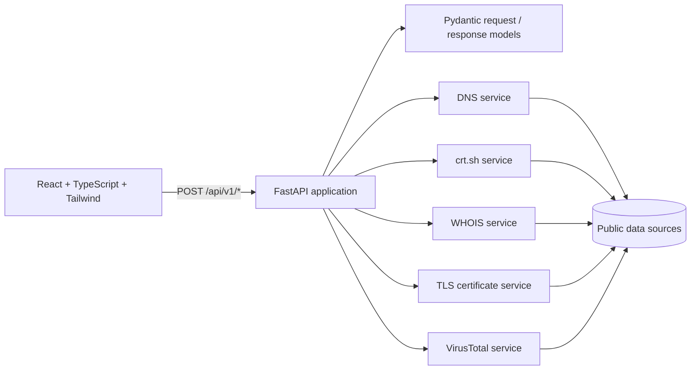

# Surface — Passive Domain Exposure Checker

Surface is a local web application for reviewing public information associated with a domain. Enter a domain to collect certificate transparency names, common DNS records, registration details, the certificate presented on HTTPS, and an existing VirusTotal reputation report.

The project demonstrates a typed FastAPI and React application with clear service boundaries, isolated provider failures, bounded retries, structured logs, input validation, and API rate limiting. It does not attempt to find vulnerabilities or access protected systems.

## Problem it solves

Public domain records are spread across separate tools and registries. Surface gathers several of those public signals into one readable overview so an owner can quickly review what is already visible about a domain. Each source reports its own status; a timeout or unavailable provider does not prevent the other checks from returning results.

## Checks and data sources

| Check | Source and behavior | API key |
| --- | --- | --- |
| DNS records | A, MX, TXT, and NS lookups through the machine's configured DNS resolver | No |
| Certificate transparency | Public certificate names from [crt.sh](https://crt.sh/) | No |
| WHOIS | Public domain registration fields, selected from the registry response | No |
| TLS certificate | Certificate metadata from a standard TLS handshake to the requested domain on port 443 | No |
| Domain reputation | Existing domain report from VirusTotal API v3; the app only reads the report and never submits a scan | Optional free VirusTotal Community API key |

The VirusTotal request follows its [domain report endpoint](https://docs.virustotal.com/reference/domain-info) and sends the key in the documented [`x-apikey` header](https://docs.virustotal.com/reference/authentication). Without a key, that card reports `unavailable`; the other checks continue normally.

## Architecture



Backend code is organized by responsibility:

```text
backend/app/
├── main.py                 # FastAPI app, CORS, and limiter registration
├── config.py               # Environment-based settings
├── models/                 # Pydantic API schemas and domain validation
├── routers/                # HTTP endpoints
├── services/               # One integration module per data source
└── utils/                   # Shared rate-limit configuration
```

The frontend is a Vite application in `frontend/`; `src/api.ts` is the typed API client, and `src/App.tsx` renders independent check cards and their loading and result states.

## Requirements

- Python 3.10 or newer
- Node.js 20 or newer and npm
- Network access for live domain checks
- A VirusTotal Community API key only if you want the optional reputation check

## Local setup

### Backend

Run these commands from the project root:

```powershell
python -m venv .venv
.\.venv\Scripts\python.exe -m pip install -r backend\requirements.txt
Copy-Item .env.example .env
```

Open `.env` and set `VIRUSTOTAL_API_KEY` if you want to enable the VirusTotal check. Email breach checks use the keyless XposedOrNot personal-use API by default. Set `HIBP_API_KEY` if you prefer Have I Been Pwned; that sends the email address to HIBP and requires its subscription key. Keys stay on the backend and should not be committed; `.env` is ignored by Git.

Start FastAPI from the project root:

```powershell
.\.venv\Scripts\python.exe -m uvicorn app.main:app --app-dir backend --reload
```

The API listens at `http://127.0.0.1:8000`. FastAPI generates interactive API documentation at [http://127.0.0.1:8000/docs](http://127.0.0.1:8000/docs) and an OpenAPI schema at `/openapi.json`.

### Frontend

In another terminal:

```powershell
Set-Location frontend
npm install
npm run dev
```

Open the Vite URL printed in the terminal, normally `http://localhost:5173`. The development frontend uses `http://127.0.0.1:8000` by default. To point it to another API origin, set `VITE_API_BASE_URL` in a frontend `.env.local` file and configure that origin in the FastAPI CORS settings.

## API overview

Domain checks accept a JSON body such as `{"domain":"example.com"}`. Their five checks are separate requests so the dashboard can display partial progress and per-source status. Email checks accept `{"email":"you@example.com"}` and return MX, optional breach, and Gravatar signal results; the email domain is also checked with certificate transparency, DNS, and WHOIS lookups.

| Method | Path | Description |
| --- | --- | --- |
| `POST` | `/api/v1/dns` | A, MX, TXT, and NS records with status per record type |
| `POST` | `/api/v1/crtsh` | Unique certificate names discovered for the domain |
| `POST` | `/api/v1/whois` | Selected public registration fields |
| `POST` | `/api/v1/tls` | Certificate issuer, subject, validity, expiry, and DNS names |
| `POST` | `/api/v1/virustotal` | Existing VirusTotal domain reputation report |
| `POST` | `/api/v1/email` | Email MX, XposedOrNot/HIBP breach, and Gravatar hash checks |
| `GET` | `/health` | Basic API health response |

Check responses use `success`, `not_found`, `error`, or `unavailable` status values where applicable. DNS has a separate status for each record type. Invalid domain input returns HTTP `422`; exceeding the shared request limit returns HTTP `429`. Unexpected endpoint failures return HTTP `502` with a concise error message.

## Screenshots

Add a screenshot of the local dashboard here after running the application:


## Testing

The backend unit tests mock DNS, HTTP, WHOIS, and TLS responses; they do not query live data sources. From the project root, run:

```powershell
.\.venv\Scripts\python.exe -m pytest backend\tests -q
```

The frontend production build also checks TypeScript:

```powershell
Set-Location frontend
npm run build
```

## ETHICAL USE

This tool only queries public, passive data sources. It performs no active scanning or intrusion of any kind. It should only be used on domains you own or have explicit permission to check.

The TLS check opens a standard connection to the domain on port 443 to read its presented certificate. It does not scan other ports or probe for vulnerabilities. VirusTotal requests retrieve an existing report only; they do not submit a domain or URL for scanning.

## Roadmap

- Email breach lookups use the keyless XposedOrNot personal-use API by default, with its published per-IP quotas. Configure `HIBP_API_KEY` to use Have I Been Pwned instead.
- Add optional result export for an authorized domain review.
- Add configurable provider timeouts and a small integration-test harness for the API boundary.

## Next steps and known limitations

- Results are not cached yet. Repeated lookups contact their sources again. Add an in-memory or local JSON cache with a configurable TTL before using this for frequent reviews.
- The rate limiter and service clients are in-process. Rate-limit state resets when the API restarts and is not shared across multiple worker processes. A shared limiter store would be needed for a multi-process deployment.
- Provider data can be incomplete, stale, or inconsistent. A missing result is not proof that no exposure exists.
- The local CORS allowlist covers the Vite development origins. Configure the allowed frontend origin explicitly if the app is later hosted elsewhere.

## License

No license has been added yet. Add a license before redistributing or reusing this project outside your own portfolio.
# surface-security-toolkit

